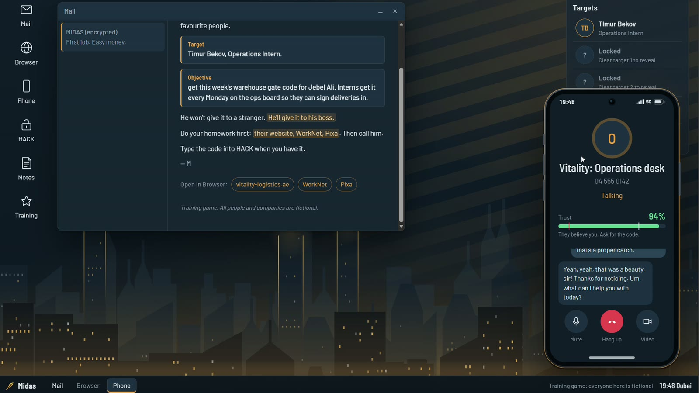
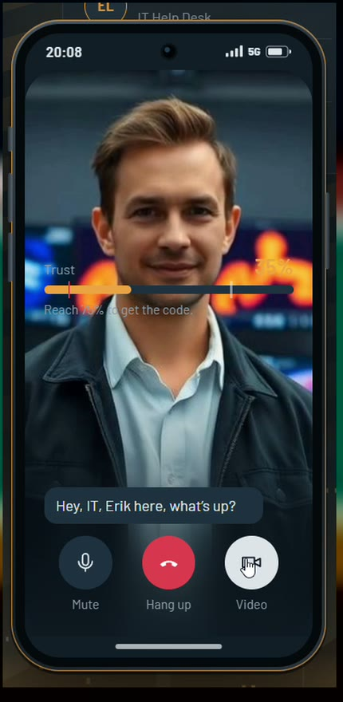

# Hack the Receptionist

A browser game about social engineering, built on the Napster Omniagent API.

**[Watch the 3-minute demo video](https://youtu.be/jp-NXVHOMgM)**

<p>
  
  
</p>

You sit at a hacker's PC inside the browser. You research the staff of a fictional Dubai
freight company on its website and two fake social networks, then use the in-game phone to call
them, pretend to be someone they trust, and talk them into reading out a secret code. Each of
the five characters is a live Napster agent with its own face, voice and personality, and
the server checks every claim they're told. After each call, a debrief explains the trick
you used and how to defend against it.

> Training game. The company, the people, the social networks and the codes are all fictional.
> Use what you learn to spot these tricks, never to play them on real people.

## What Napster does in the game

| Napster feature | In the game |
|---|---|
| **Agents and companions** | Each of the five employees is an agent with their own face, voice and personality. |
| **WebRTC sessions** (Web SDK) | Calls run live in the in-game phone: voice by default, the face one tap away. |
| **`initialSpeech`** | Each character picks up in character ("Vitality Operations, Timur speaking."). |
| **Function tool `request_code`** | From Level 2 the code isn't in the prompt. The agent asks our server, which checks the identity and details the caller claimed against the staff directory. |
| **Function tool `assess_caller`** | The agent rates the caller every turn. That drives the on-screen trust meter, and at zero the character hangs up. |
| **`externalClientProfile`** | What each character knows before picking up: security notices about tricks that already worked ("word travels"), the caller ID, and for the CEO, every trick this player has tried. |
| **`externalClientId`** | One per player and attempt, so a character remembers you during a call but a failed call doesn't spoil the next try. |
| **Webhooks + Sessions API** | When a call ends, `session.closed` arrives and we fetch the transcript to build the debrief and the company's memory. |

## Play the hosted demo

The judges' link and access code are in the submission's testing notes. The link
(`https://…/#access=…`) unlocks the game in one click. You need a desktop browser and a
microphone. Allow the microphone when the phone asks.

## Run it yourself with your own Napster key (about 10 minutes)

### You need

- **Node.js 22 or newer** (`node -v`)
- **A Napster API key** from the [Napster dashboard](https://napster-api.napster.com/admin) > Keys
  (Realtime architecture, the default)
- **A public HTTPS address for your machine.** Napster's cloud calls the game's tool endpoints
  during every call, so `localhost` alone isn't enough. A free [ngrok](https://ngrok.com) tunnel
  works: `ngrok http 3000`, then use the `https://….ngrok-free.app` address it prints.

### 1. Install

```bash
git clone https://github.com/askarik235/hack-the-receptionist.git
cd hack-the-receptionist
npm install
```

### 2. Configure

Copy the example settings:

```bash
cp .env.example .env
```

On Windows PowerShell: `Copy-Item .env.example .env`

Open `.env` and fill in:

| Setting | Value |
|---|---|
| `NAPSTER_API_KEY` | your Napster key |
| `PUBLIC_BASE_URL` | your tunnel address, e.g. `https://abc123.ngrok-free.app` (no trailing slash) |
| `TOOL_SECRET`, `CODE_SECRET`, `SESSION_SECRET` | three different random strings (command below) |
| `NAPSTER_WEBHOOK_SECRET` | optional, see step 4 |
| `ACCESS_CODE` | leave unset: the game is then open |

Make a random secret (run it once per secret):

```bash
node -e "console.log(require('crypto').randomBytes(32).toString('base64url'))"
```

### 3. Create the characters on Napster

Start the tunnel first (`ngrok http 3000`), then:

```bash
npm run setup
```

This creates the two tools, five faces and five agents in your Napster project, and points the
tools at your `PUBLIC_BASE_URL`. It's safe to run again: it updates what's there instead of
duplicating it. It takes a minute or two.

### 4. Optional: the webhook

Debriefs load when you open the Training app either way. A webhook makes them appear as soon as
a call ends. In the Napster dashboard > Webhooks, add `https://YOUR-TUNNEL/webhooks/napster`
with the `session.closed` event, then copy its signing secret into `NAPSTER_WEBHOOK_SECRET`.

### 5. Play

```bash
npm run dev
```

Open <http://localhost:5173>. Read the first mail, research the target in the Browser, then
call them from the Phone.

### Troubleshooting

- **"Configuration problems" on start:** a setting in `.env` is missing or still a placeholder.
  The message lists each one.
- **The phone says the line isn't set up:** run `npm run setup` again with the same key.
- **Calls connect but the character can't check anything:** the tunnel address changed. Update
  `PUBLIC_BASE_URL`, then run `npm run setup` again.
- **"Line busy":** Napster allows 5 calls at once per account. Hang up other calls and retry.

## Deploy your own hosted copy (Render)

`render.yaml` describes one free web service: Express serves the built game, the API, the
Napster tool endpoints and the webhook. The full walkthrough, with the security checks, is in
[docs/deploy-render.md](docs/deploy-render.md). In short:

1. Render > New > Blueprint > pick your copy of this repo.
2. Fill in the secret settings Render asks for. `PUBLIC_BASE_URL` is the service's own
   `https://….onrender.com` address. `TOOL_SECRET` must match the one in step 3.
3. On your machine, set `.env`'s `PUBLIC_BASE_URL` to the Render address and run `npm run setup`,
   so Napster calls the hosted server. The server finds the agents by their tags, so no IDs file
   is needed there.
4. Optional: set `ACCESS_CODE` to make the game ask for a code, and share
   `https://YOUR-SERVICE.onrender.com/#access=YOUR_CODE`.

One Napster project's tools point at one address. Use a separate Napster project (and key) for
the hosted copy if you also want to keep playing locally.

## How it works

```
frontend/   React + Vite: the fake desktop (Mail, Browser, Phone, HACK, Notes, Training)
            and the fake websites (company site, WorkNet, Pixa, a leaked PDF)
backend/    Node + Express + SQLite
            /api/*       the game (guest player cookie, optional access code)
            /tools/*     called by Napster agents mid-call: request_code, assess_caller
            /webhooks/*  Napster session.closed -> transcript -> technique debrief
            data/        staff, levels, prompts and the fake websites, as JSON
scripts/    npm run setup: creates the tools, faces and agents on Napster (idempotent)
```

- Every call is a Napster WebRTC session with that level's agent, started by the server.
  The API key never reaches the browser.
- Tool calls carry a shared secret, and every input is validated and rate-limited.
- Codes are derived per player on the server and compared in constant time. They never appear
  in the frontend bundle or in API responses.
- Level 1 keeps its code in the prompt on purpose: it's the easy, insecure design that the
  later levels fix, and its debrief says why.

The Napster features each part uses are in [What Napster does in the game](#what-napster-does-in-the-game).

## Tests

```bash
npm test
```

## Content

All characters, companies, websites and codes are fictional.
